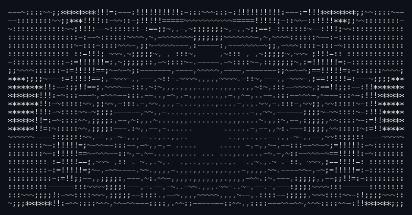

# Adriel Kourlate
**Data Science · Relational SQL Architecture · Quantitative Machine Learning**

Dual-degree Centrale Nantes × Audencia · Visiting Shenzhen University

 

 

### 🔬 Selected Work & Engineering

#### 01 / [GravityNotch: a Dynamic Island for the MacBook Notch](https://github.com/adrielakak/GravityNotch)
*Native macOS app · Built in close collaboration with AI coding agents*
- **Lock Screen Media Player:** Tapping the cover turns it into a full screen wallpaper, using the Apple Music animated artwork when it exists (HLS variant selection, local caching, seamless looping in up to 2160p).
- **Live Coding Agent Monitor:** Follows Claude Code, Codex and Antigravity sessions from the notch, with pixel mascots, a progress checklist, diff counters and a speech bubble when an agent finishes or needs input.
- **AI-Augmented Engineering:** Fork of the open source boring.notch, extended feature by feature by directing AI agents: I set the product vision, test on real hardware and iterate, which lets one student ship what would normally take a small team.
- `Swift` `SwiftUI` `AppKit` `AVFoundation` `AppleScript` `Claude Code`
- 🔗 **[GitHub Repository](https://github.com/adrielakak/GravityNotch)**

 

#### 02 / [Train DB — Railway SQL System & Relational Architecture](https://portfolio-nu-eosin-a953g7hsv2.vercel.app/projects/DB_Lab_2_AdrielKourlate.pdf)
*Relational Database Modeling & Query Optimization*
- **Data Architecture:** Designed complete conceptual (ERD) and logical (MLD) schemas normalized to **3rd Normal Form (3NF)** across 14 interconnected relations.
- **Query Engineering & Audit:** Implemented multi-table analytical joins, index tuning, composite foreign key constraints, and transactional consistency validation.
- `PostgreSQL` `SQL Optimization` `ERD / MLD` `Data Quality Audit`
- 🔗 **[Full Engineering Report (PDF)](https://portfolio-nu-eosin-a953g7hsv2.vercel.app/projects/DB_Lab_2_AdrielKourlate.pdf)**

 

#### 03 / [Electoral Dynamics (2002–2022)](https://github.com/adrielakak/project-election)
*Statistical & Geospatial Data Science*
- **20-Year Longitudinal Study:** Department-level econometric analysis tracking French presidential voter turnout, abstention trends, and geographical political realignments.
- **Geospatial Modeling:** Processed multi-decade electoral datasets with automated GeoJSON spatial joins, choropleth mapping, and interactive Plotly visual analytics.
- `Python` `Pandas` `Plotly` `GeoJSON` `Statistical Analysis`
- 🔗 **[GitHub Repository](https://github.com/adrielakak/project-election)**

 

#### 04 / [Personal Portfolio & Interactive Case Studies](https://portfolio-nu-eosin-a953g7hsv2.vercel.app)
*Interactive Web & Data Systems Showcase*
- **Engineering Showcase:** Bilingual platform presenting database architecture reports, statistical notebooks, and quantitative ML implementations.
- **Creative Web:** Custom Three.js background shaders and GSAP animations running at 60 fps.
- `JavaScript` `Three.js` `GSAP` `Vercel`
- 🔗 **[Explore Portfolio](https://portfolio-nu-eosin-a953g7hsv2.vercel.app)**
