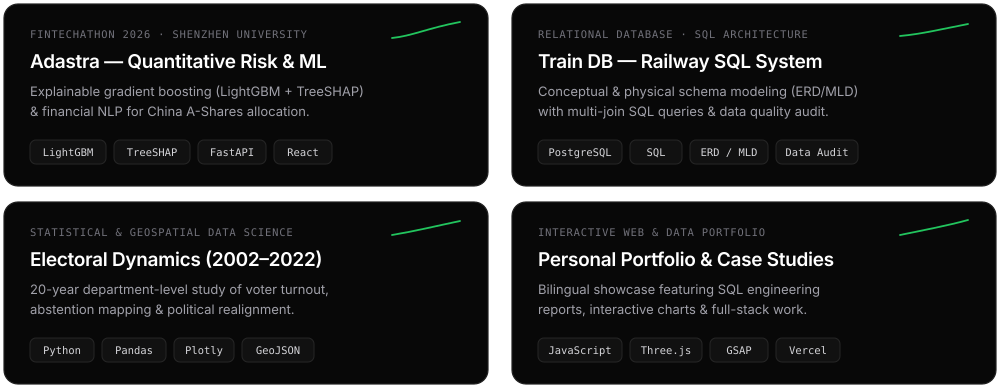
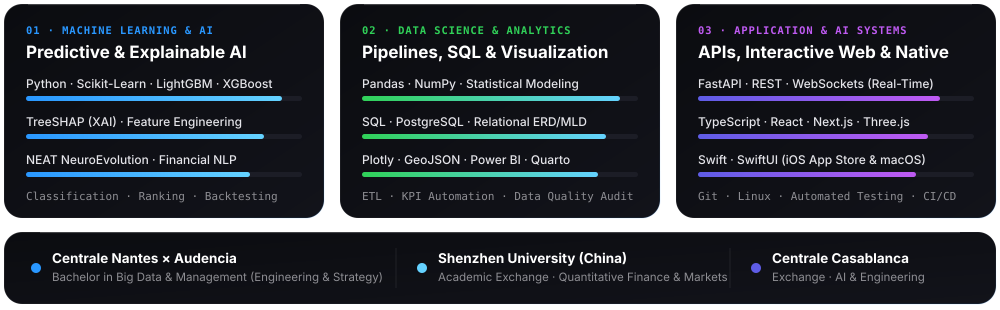

 

 

### Selected Data Science & AI Engineering Work

  

| System | Domain & Methodology | Core Stack | Links |
| :--- | :--- | :--- | :---: |
| **[Adastra (`webank`)](https://github.com/adrielakak/webank)** | Quantitative risk advisory & China A-Shares allocation cockpit (FinTechathon 2026 — WeBank Track). Cost-sensitive gradient boosting, explainable AI diagnostics, and financial news NLP. | `Python` `LightGBM` `TreeSHAP` `FastAPI` `React` `Quarto` | [Repo](https://github.com/adrielakak/webank) · [Live](https://webank-tawny.vercel.app) |
| **[AutoPilot FSD (`autopilot`)](https://github.com/adrielakak/autopilot)** | Real-time autonomous driving simulation evolving 50 neural agents across intersections using NEAT neuroevolution and 15-channel semantic LIDAR at 60 Hz. | `Python` `NEAT` `FastAPI` `WebSockets` `Three.js` `TypeScript` | [Repo](https://github.com/adrielakak/autopilot) |
| **[Electoral Dynamics (`project-election`)](https://github.com/adrielakak/project-election)** | Longitudinal statistical & geospatial study of 20 years of French presidential elections (2002–2022) at department scale: turnout modeling, abstention mapping, and political realignment. | `Python` `Pandas` `Plotly` `GeoJSON` `Jupyter` | [Repo](https://github.com/adrielakak/project-election) |
| **[Algobot](https://github.com/adrielakak/Algobot) & [Signal](https://github.com/adrielakak/signal)** | Ensemble ML market prediction pipeline (`XGBoost`, `LightGBM`), OHLCV feature engineering via `CCXT`, interactive strategy backtesting CLI, and automated PDF analytics. | `Python` `XGBoost` `Scikit-Learn` `Pandas` `CCXT` | [Algobot](https://github.com/adrielakak/Algobot) · [Signal](https://github.com/adrielakak/signal) |
| **[GravityNotch](https://github.com/adrielakak/GravityNotch) & [RecoMemo](https://apps.apple.com/app/recomemo)** | Native Apple ecosystem engineering: macOS Tahoe Dynamic Island with Screen OCR & AI Agent Telemetry (`GravityNotch`) and smart recommendation iOS app on the App Store (`RecoMemo`). | `Swift` `SwiftUI` `Vision OCR` `macOS` `iOS` | [GravityNotch](https://github.com/adrielakak/GravityNotch) · [App Store](https://apps.apple.com/app/recomemo) |

 

### Technical Architecture & Academic Track

  

 

### Contribution Activity

  <picture>
    <source media="(prefers-color-scheme: dark)" srcset="https://raw.githubusercontent.com/adrielakak/adrielakak/output/github-contribution-grid-snake-dark.svg" />
    <source media="(prefers-color-scheme: light)" srcset="https://raw.githubusercontent.com/adrielakak/adrielakak/output/github-contribution-grid-snake.svg" />
    
  </picture>

