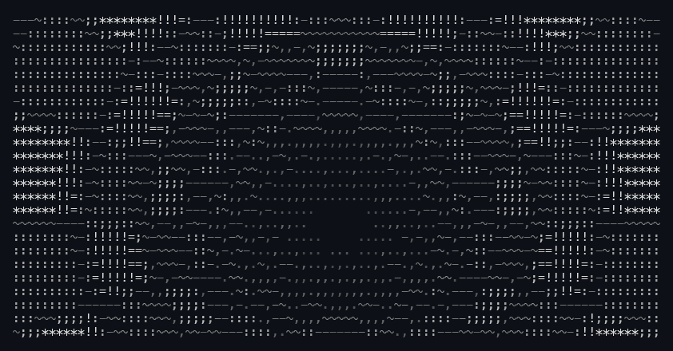

# Adriel Kourlate
**Data Science · Relational SQL Architecture · Quantitative Machine Learning**

Dual-degree Centrale Nantes × Audencia · Visiting Shenzhen University

 

 

### 🔬 Selected Work & Engineering

#### 01 / [Adastra — Quantitative Risk & ML Cockpit](https://webank-tawny.vercel.app)
*FinTechathon 2026 · Shenzhen University*
- **Explainable Gradient Boosting:** Developed high-throughput LightGBM pipelines paired with **TreeSHAP** for factor attribution and risk decomposition across China A-Shares.
- **Financial NLP & Allocation:** End-to-end sentiment scoring and signal generation served via a low-latency **FastAPI** backend and interactive React analytics interface.
- `Python` `LightGBM` `TreeSHAP` `FastAPI` `React`
- 🔗 **[Live Cockpit Demo](https://webank-tawny.vercel.app)** · **[GitHub Repository](https://github.com/adrielakak/webank)**

 

#### 02 / [Train DB — Railway SQL System & Relational Architecture](https://portfolio-nu-eosin-a953g7hsv2.vercel.app/projects/DB_Lab_2_AdrielKourlate.pdf)
*Relational Database Modeling & Query Optimization*
- **Data Architecture:** Designed complete conceptual (ERD) and logical (MLD) schemas normalized to **3rd Normal Form (3NF)** across 14 interconnected relations.
- **Query Engineering & Audit:** Implemented multi-table analytical joins, index tuning, composite foreign key constraints, and transactional consistency validation.
- `PostgreSQL` `SQL Optimization` `ERD / MLD` `Data Quality Audit`
- 🔗 **[Full Engineering Report (PDF)](https://portfolio-nu-eosin-a953g7hsv2.vercel.app/projects/DB_Lab_2_AdrielKourlate.pdf)**

 

#### 03 / [Electoral Dynamics (2002–2022)](https://github.com/adrielakak/project-election)
*Statistical & Geospatial Data Science*
- **20-Year Longitudinal Study:** Department-level econometric analysis tracking French presidential voter turnout, abstention trends, and geographical political realignments.
- **Geospatial Modeling:** Processed multi-decade electoral datasets with automated GeoJSON spatial joins, choropleth mapping, and interactive Plotly visual analytics.
- `Python` `Pandas` `Plotly` `GeoJSON` `Statistical Analysis`
- 🔗 **[GitHub Repository](https://github.com/adrielakak/project-election)**

 

#### 04 / [Personal Portfolio & Interactive Case Studies](https://portfolio-nu-eosin-a953g7hsv2.vercel.app)
*Interactive Web & Data Systems Showcase*
- **Engineering Showcase:** Bilingual platform presenting database architecture reports, statistical notebooks, and quantitative ML implementations.
- **Creative Web:** Custom Three.js background shaders and GSAP animations running at 60 fps.
- `JavaScript` `Three.js` `GSAP` `Vercel`
- 🔗 **[Explore Portfolio](https://portfolio-nu-eosin-a953g7hsv2.vercel.app)**
