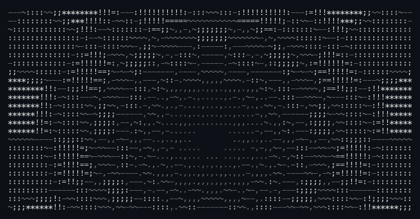

# Adriel Kourlate
**Software Engineering · Data & SQL · Quantitative ML**

Dual-degree Centrale Nantes × Audencia · Visiting Shenzhen University

 

 

### Selected Software & Data Projects

#### 01 / [GravityNotch](https://github.com/adrielakak/GravityNotch) · `Swift` `SwiftUI` `AppKit` `macOS`
Native macOS Dynamic Island app (fork of *boring.notch*), shipped across **9 releases (`v1.2.6`)** with Sparkle auto-updates and a [dedicated website](https://adrielakak.github.io/GravityNotch/).
- **Engineering:** `SkyLight` lock screen media player (synced lyrics & HLS animated artwork), macOS Tahoe hardware HUDs, screen OCR, clipboard history, and live Claude Code / Codex / Antigravity session tracking.

#### 02 / [Adastra (`webank`)](https://github.com/adrielakak/webank) · `FastAPI` `React` `TypeScript` `LightGBM` `TreeSHAP`
Full-stack quantitative risk & allocation cockpit built for FinTechathon 2026 ([live demo](https://webank-tawny.vercel.app)).
- **Engineering:** Leak-free walk-forward ML pipeline, analytic TreeSHAP attribution, CSRC `R1`–`R5` suitability guardrails with SHA-256 audit seals, and Quarto technical & security documentation.

#### 03 / [llm-dedup-rs](https://github.com/adrielakak/llm-dedup-rs) · `Rust` `PyO3` `Rayon` `Python` `MinHash LSH`
High-performance LLM corpus cleaning and deduplication engine written in Rust and exposed natively to Python (`abi3`).
- **Engineering:** GIL-free multi-core HTML stripping, 64-bit `FxHash` exact deduplication, and contiguous `Vec<u32>` MinHash LSH (`337.9×`–`521.9×` speedup and `-69.2%` net RAM overhead vs. pure Python).

#### 04 / [Train DB](https://portfolio-nu-eosin-a953g7hsv2.vercel.app/projects/DB_Lab_2_AdrielKourlate.pdf) · `PostgreSQL` `SQL` `ERD` `psycopg2`
Relational database schema audit and analytical SQL querying across a 14-table national railway network ([engineering report PDF](https://portfolio-nu-eosin-a953g7hsv2.vercel.app/projects/DB_Lab_2_AdrielKourlate.pdf)).
- **Engineering:** ERD-vs-physical schema verification, multi-table `INNER`/`LEFT` joins, self-joins, `WITH` CTEs, null-safe temporal aggregations, and automated lookup scripting via `psycopg2`.
